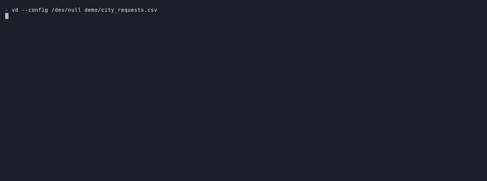

# vd-jev

[VisiData](https://www.visidata.org/) is a terminal tool for exploring and arranging tabular data. It opens CSV, TSV, JSON, SQLite, Excel, Parquet and many other formats, and a few keystrokes are enough to sort, filter, aggregate, pivot, plot and save them. It is a wonderful tool for anyone who has to explore, look at and summarize structured data.

vd-jev is a VisiData plugin that asks closed questions about every cell of a text column and writes the answers back as typed columns: a probability (yes/no), a label from a fixed list, or a position on an ordered scale, each with a calibrated confidence. Answers come from Jev, TypeSafe's decision model, by default, or from any other decision model on [OpenRouter](https://openrouter.ai/docs/guides/community/jev).

It brings to VisiData the idea behind MotherDuck's [`prompt_jev()`](https://motherduck.com/docs/sql-reference/motherduck-sql-reference/ai-functions/prompt-jev/) SQL function.

**Your data leaves your computer.** The text of every cell you ask about is sent to OpenRouter and from there to the servers of the provider of the chosen model (TypeSafe, in the United States, for the default Jev). Use it on data you are allowed to share with them; see [Privacy](#privacy).

**Click the animation to open it full size, where the text is easier to read.**

[](https://raw.githubusercontent.com/ondata/vd-jev/main/demo/demo.gif)

## Contents

- [Why a decision model](#why)
- [Requirements](#requirements)
- [Installation](#installation)
- [Quick start](#quick-start)
- [What it does](#what-it-does)
- [A real example: EU public procurement](#ted)
- [A larger test: EU research projects](#cordis)
- [Checking official data](#quality)
- [Choosing a model](#choosing-a-model)
- [Cost](#cost)
- [Privacy](#privacy)
- [Options](#options)
- [Columns reference](#columns)
- [Tests](#tests)
- [License](#license)

<a id="why"></a>
## Why a decision model

If you love VisiData but have not used AI models much with it, this is the simplest place to start.

The AI models most people know are chat models: you write a prompt, they write text back. Text is hard to put in a table: it has to be read, parsed, checked. Decision models such as Jev work the other way round: you ask a closed question and they never answer with text, only with a quick, typed classification.

Start from a table with a column of free text, like `demo/city_requests.csv`:

| id | district | message |
|---|---|---|
| 1 | North | A tree has fallen across Elm Street after the storm and blocks both lanes. |
| 2 | Central | Please add a bench near the duck pond in Riverside Park. |
| 3 | East | The bar on Market Square plays loud music until 3am every night. |
| 4 | West | |
| 7 | Central | Road works on King Street start at 5am and wake the whole block. |

Ask three questions about the `message` column, one `jev-column` each:

| Question | Answers | Kind of answer |
|---|---|---|
| Does the message report a safety hazard? | *(empty)* | yes/no: the probability of yes, 0 to 1 |
| Which department should handle this? | `roads, parks, noise` | one of your labels, with a confidence |
| How urgent is this request? | `low < medium < high` | a place on your scale, 0 (low) to 2 (high), with a confidence |

and the same table comes back with typed columns next to the text:

| id | message | message_noul | message_choice | message_choice_conf | message_score | message_score_conf |
|---|---|---|---|---|---|---|
| 1 | A tree has fallen across Elm Street after the storm and blocks both lanes. | 0.97 | roads | 0.98 | 1.96 | 0.93 |
| 2 | Please add a bench near the duck pond in Riverside Park. | 0.03 | parks | 1.00 | 0.10 | 0.86 |
| 3 | The bar on Market Square plays loud music until 3am every night. | 0.16 | noise | 1.00 | 0.98 | 0.13 |
| 4 | | | | | | |
| 7 | Road works on King Street start at 5am and wake the whole block. | 0.18 | roads | 0.79 | 0.74 | 0.00 |

These are real answers from Jev 1.14 on the demo file (2026-10-18). The empty message is skipped. Row 7 shows the confidence at work: road works that wake people up sit between `roads` and `noise`, and the confidence drops to 0.79; on urgency it is 0.00. Those are the rows to read by hand.

In VisiData this changes what you can do with a column of free text. Once the answers are columns, everything you already know applies: `Shift+F` counts the requests per department, `[` and `]` sort by urgency, `z|` selects the hazards, or the rows where the model is unsure (low confidence), so you read by hand only those. Tickets to route, survey answers to code, complaints to triage, descriptions to tag: a few cents for thousands of rows (see [Cost](#cost)), instead of reading them all.

<a id="requirements"></a>
## Requirements

- VisiData 3.4 (Python 3.9 or later). No other package is needed.
- An [OpenRouter](https://openrouter.ai/) account with some credit: every row is a paid request (see [Cost](#cost)).
- An OpenRouter API key, created at <https://openrouter.ai/keys>, in the `OPENROUTER_API_KEY` environment variable of the shell that starts VisiData:

  ```bash
  export OPENROUTER_API_KEY=sk-or-...
  ```

  To keep it across sessions, add that line to your shell startup file (`~/.bashrc`, `~/.zshrc`). The key is read only from the environment, never from VisiData options.

The plugin checks these before sending anything. Without the key, the command stops with `set $OPENROUTER_API_KEY` and adds no columns. With a key that OpenRouter refuses (invalid, revoked, or without credit), the run stops at the first refusal and reports the reason given by OpenRouter.

<a id="installation"></a>
## Installation

The plugin is a single file with no dependencies beyond VisiData itself, and VisiData loads it automatically.

```bash
uv tool install visidata --with git+https://github.com/ondata/vd-jev
```

or, from a local clone:

```bash
uv tool install visidata --with-editable ~/git/vd-jev
```

If VisiData is already installed as a `uv tool` with extra packages, add `--reinstall` and repeat every `--with` you already use: reinstalling drops any extra that is not passed again.

<a id="quick-start"></a>
## Quick start

A tour of the plugin on the small demo file (ten messages to a city's service desk, one of them empty). It makes about thirty requests, less than 0.001 USD with Jev.

1. Open the file. VisiData reads it straight from GitHub:

   ```bash
   vd https://raw.githubusercontent.com/ondata/vd-jev/main/demo/city_requests.csv
   ```

2. Move the cursor to the `message` column, with the right arrow or `l`, or press `c`, type `^message$` and `Enter`.

3. Ask a yes/no question. Press `Space`, type `jev-column` and press `Enter` (the same command is in the menu: `Alt+c`, or a click on Column, then Jev, then all rows). A form opens with two fields, `question` at the bottom and `answers` above it. Type

   ```
   Does the message report a safety hazard?
   ```

   in `question`, leave `answers` empty, and press `Enter`. A `message_noul` column appears to the right of `message`, with the probability of yes for each row; the empty message stays empty. The status at the bottom reports rows answered, skipped, errors and cost. The cursor stays on `message`, ready for the next question.

4. Pick one label. `Space`, `jev-column`, `Enter`; in `question` type `Which department should handle this?`, press `Tab` to move to `answers`, type `roads, parks, noise`, press `Enter`. You get `message_choice`, `message_choice_conf` and `message_choice_p`.

5. Count the answers. Press `l` to move to `message_choice`, then `Shift+F`: a frequency table of the departments. `q` goes back.

6. Ask for a place on a scale. Press `h` to go back to `message`, then `Space`, `jev-column`, `Enter`; question `How urgent is this request?`, `Tab`, answers `low < medium < high`, `Enter`. You get `message_score` (0 is low, 2 is high), `message_score_conf` and `message_score_p`.

7. Find the rows to read by hand. Press `l` twice to reach `message_score_conf`, `[` to sort by it, then `z|`, type `0 < message_score_conf < 0.5` and `Enter`: the rows where the model is unsure are selected.

8. Save with `Ctrl+S` and a file name, for example `requests.csv`. Hidden columns are not saved; press `gv` before saving to keep the `_raw` columns too.

`Ctrl+Q` quits VisiData.

<a id="what-it-does"></a>
## What it does

Put the cursor on a column of text, press `Space`, type `jev-column` (or `jev-selected` for the selected rows only), and fill in the form: `Tab` moves between the two fields, `Enter` sends.

| `question` | `answers` | New columns |
|---|---|---|
| Does the message report a safety hazard? | *(empty)* | `message_noul`: probability of yes, 0 to 1 |
| Which department should handle this? | `roads, parks, noise` | `message_choice`: one of the labels; `message_choice_conf`; `message_choice_p`: the probability of every label |
| How urgent is this request? | `low < medium < high` | `message_score`: 0 (low) to 2 (high); `message_score_conf`; `message_score_p`: the probability of every level |

What you write in `answers` sets the kind of question: nothing for yes/no, labels separated by commas to pick one, levels separated by `<` (lowest first) for an ordered scale.

A label or level can carry a description in parentheses, for the model only: it tells the model where the label ends, and it is never returned. Columns and values keep the short labels.

```
roads (streets, sidewalks, potholes, markings, street lighting), parks (green areas, playgrounds, benches), noise (anything that disturbs rest)
low (can wait) < medium (this week) < high (danger now)
```

On the demo file this changes only the borderline rows. Without descriptions, "A streetlight on the path through Central Park has been out for a week" goes to `parks` (confidence 0.89); with "street lighting" under `roads`, it goes to `roads` (0.52). Clear messages keep the same label.

When your labels might not cover every row, add an `other` label, as TypeSafe recommends: otherwise the model has to pick one of the labels it is given, even when none fits.

The rest works as usual. Empty cells are skipped. The cursor stays on the text column, so you can ask the next question right away; a status message reports rows answered, skipped, errors and cost. Each run also adds a hidden `_raw` column with the full answer as JSON, or the error for that row: `gv` shows hidden columns. VisiData saves only visible columns, so show `_raw` before saving if you want to keep it.

The new columns are ordinary VisiData columns. In the demo above:

- `Shift+F` on `message_choice` counts the requests per department;
- `(` on `message_choice_p` expands it into one number column per label (`message_choice_p.roads`, `message_choice_p.parks`, `message_choice_p.noise`), to sort or filter on the second choice too;
- `z|` with `0 < message_score_conf < 0.5` selects the rows where the model is unsure, to read them by hand (the `0 <` leaves out the empty row).

Try it on the demo file:

```bash
vd demo/city_requests.csv
```

<a id="ted"></a>
## A real example: EU public procurement

`demo/ted_sample.csv` holds 1,000 random contract notices published in 2022 by buyers in Ireland, Malta and the United Kingdom, all in English: who is buying (`buyer`), its main activity as declared by the buyer itself (`main_activity`), and, for 55 notices, the award criteria (`award_criteria`). Source: [Tenders Electronic Daily (TED) csv subset](https://data.europa.eu/data/datasets/ted-csv), "TED - Contract notices 2022", European Commission, DG GROW, licence [CC BY 4.0](https://creativecommons.org/licenses/by/4.0/); one row per notice, columns renamed.

Two questions on the `buyer` column, 1,000 rows each, about 45 seconds and 0.012-0.014 USD per question with Jev:

| `buyer` | `main_activity` | The buyer is a hospital or other health care provider | What kind of organisation is this buyer? |
|---|---|---|---|
| Beaumont Hospital | Health | 0.66 | hospital or health service (1.00) |
| Health Service Executive (HSE) | Health | 0.74 | national ministry or agency (0.48) |
| Health Information and Quality Authority (HIQA) | Health | 0.47 | national ministry or agency (1.00) |
| Trinity College Dublin, the University of Dublin | Education | 0.08 | school or university (1.00) |
| Wicklow County Council | General public services | 0.14 | municipality or local government (1.00) |
| Mayo, Sligo and Leitrim ETB | Education | 0.53 | school or university (0.39) |
| Department of Contracts | Health | 0.26 | other (0.75) |

The labels for the second question were `municipality or local government, hospital or health service, school or university, national ministry or agency, utility or transport company, other`.

Compared with `main_activity = Health`, at a 0.5 threshold:

- when the model says yes, it is right 56 times out of 59 (95%);
- it finds 56 of the 120 health buyers. 54 of the 64 it misses are the same buyer, Malta's "Department of Contracts", a central purchasing body: nothing in its name says health, so no question on this column can find it. Without it, the model finds 56 of 66 (85%);
- most of the other misses are regulators and research bodies (HIQA, the Health Research Board, the Nursing and Midwifery Board): the question asked about care providers, and the model reads it literally;
- the three wrong yeses are all one education and training board, at 0.53 to 0.61, just above the threshold.

What this shows: the model judges only what is in the cell, and its yes is reliable; when the cell does not hold the information, ask about another column or accept that no question will find it.

Label descriptions make a large difference on the second question. The same labels, each with a description in parentheses:

```
municipality or local government (county, city and town councils, local authorities),
hospital or health service (hospitals, clinics, national or regional health services that run care),
school or university (schools, colleges, universities, institutes of technology, education and training boards),
national ministry or agency (government departments, national agencies, regulators, central purchasing bodies),
utility or transport company (energy, water, waste, rail, bus, ports, airports),
other (charities, foundations, private companies, anything else)
```

(one line in the form; split here to read it). Against `main_activity`, leaving out Malta's "Department of Contracts":

| `main_activity` | Rows | Labelled as expected, without descriptions | With descriptions |
|---|---|---|---|
| Education, expected `school or university` | 264 | 196 (74%) | 233 (88%) |
| Health, expected `hospital or health service` | 66 | 28 (42%) | 56 (85%) |

The education and training boards moved from `municipality or local government` to `school or university` (35 rows), and the Health Service Executive from `national ministry or agency` to `hospital or health service` (28 rows). The descriptions name kinds of organisations, not the buyers in the file. Scripts: `demo/ted_questions.py`, `demo/ted_descriptions.py`.

<a id="cordis"></a>
## A larger test: EU research projects

`demo/cordis_sample.csv` holds 1,000 random Horizon 2020 projects, each with its objective in English (a paragraph, about 2,000 characters) and the field of science CORDIS assigns to it from the [euroSciVoc](https://op.europa.eu/en/web/eu-vocabularies/euroscivoc) classification; only projects with a single top-level field were drawn. Source: [CORDIS - EU research projects under Horizon 2020](https://data.europa.eu/data/datasets/cordish2020projects), Publications Office of the European Union, reused under the [Commission reuse decision](https://eur-lex.europa.eu/eli/dec/2011/833/oj) with attribution.

One question on the `objective` column, 1,000 rows, about 45 seconds and 0.03 USD:

- question: `Which field of science is this research project mainly about?`
- answers: `natural sciences, engineering and technology, medical and health sciences, agricultural sciences, social sciences, humanities`, then the same labels with descriptions listing their disciplines (as `natural sciences (mathematics, computer and information sciences, physics, chemistry, earth and environmental sciences, biology)`); the full text is in `demo/cordis_questions.py`.

| Field in CORDIS | Projects | Same field, without descriptions | With descriptions |
|---|---|---|---|
| natural sciences | 475 | 334 | 362 |
| engineering and technology | 182 | 150 | 152 |
| medical and health sciences | 150 | 139 | 134 |
| social sciences | 145 | 92 | 98 |
| humanities | 39 | 32 | 35 |
| agricultural sciences | 9 | 5 | 5 |
| **all** | **1,000** | **752 (75%)** | **786 (79%)** |

Confidence separates the answers to trust from those to read: with descriptions, 825 answers have a confidence of 0.8 or more and 85% of them match CORDIS; the 175 below 0.8 match only about half of the time.

Most disagreements are on the line between natural sciences and engineering (73 projects CORDIS puts in natural sciences, the model in engineering), and the reference is not always right either: "Efficient and Eco-friendly Construction Of Revolutionary surfboard blanKs" is filed by CORDIS under astronomy and planetary sciences, and by the model under engineering (confidence 1.00). In CORDIS, 30 of the 1,000 projects are flagged as human-validated; what the flag covers is not documented.

<a id="quality"></a>
## Checking official data

The same columns turn the plugin into a data quality check. When the model is very sure and the official classification says something else, the row is worth a look. In VisiData, on the CORDIS sample after the question with descriptions:

```
z|   objective_choice != field and objective_choice_conf >= 0.95
```

selects 85 of the 1,000 projects. In some of them the official label looks surprising next to the objective, and matches a single word of it:

| Project | Field of science in CORDIS | A word in the objective that matches it | Plugin |
|---|---|---|---|
| [Pulsehaler](https://cordis.europa.eu/project/id/968565), a device to treat COPD | sociology / demography / mortality | "kills 160,000 every year" | medical and health sciences (1.00) |
| [e2CORK](https://cordis.europa.eu/project/id/673635), surfboard blanks made of cork | astronomy / planetary sciences / planets | "carbon footprint on our planet" | engineering and technology (1.00) |
| [HYPERNEX](https://cordis.europa.eu/project/id/101015145), a European hyperloop network | ecology / ecosystems; catalysis | "the need for a catalyst", "R&D ecosystem" | engineering and technology (1.00) |
| [ACROBA](https://cordis.europa.eu/project/id/101017284), cognitive robots for production lines | ecology / ecosystems | "production environments" | engineering and technology (0.98) |

This is a demonstration of what the plugin makes possible, not evidence that these four labels are wrong. The model read only the text in the CSV (the objective); CORDIS may classify a project using much more of what is available about it online, such as keywords, publications and deliverables, and on a closer look its labels may well be right. Other selected rows are errors of the model, or projects that sit between two fields.

What the selection gives is a short list to read instead of 1,000 rows. After checking each case against the full project record, what still looks wrong is something to ask the publisher about, with the links.

<a id="choosing-a-model"></a>
## Choosing a model

The plugin talks to OpenRouter rather than to TypeSafe directly: with one key and one request format it can use any decision model OpenRouter serves through its Decisions API (Jev, Perplexity Decider, Microsoft Decision, Cloudflare Clef and others; see the [live catalog](https://openrouter.ai/api/v1/models?output_modalities=decisions)). Jev 1.14 is the default; to use another model, set `jev_model`:

```python
# ~/.visidatarc
vd.options.jev_model = 'perplexity/pplx-decider-flash-v1.2'
```

or press `Shift+O` inside VisiData, or start it with `vd --jev-model=perplexity/pplx-decider-flash-v1.2` (with `=`: with a space VisiData reads the value as a file to open).

Probabilities and confidences are not comparable across models: a threshold that works with one model has to be checked again with another.

<a id="cost"></a>
## Cost

Each row is one request, billed by OpenRouter on input tokens. Measured on the demo file (short messages, one question), on 2026-10-18:

| Model | Per row | 1,000 rows |
|---|---|---|
| `typesafe/jev-1.14` (default) | about 0.000012 USD | about 0.012 USD |
| `perplexity/pplx-decider-flash-v1.2` | about 0.000001 USD | about 0.001 USD |

Longer texts and more labels cost more, in proportion to the tokens sent; the status message at the end of each run reports the real cost. Above 100 non-empty rows (`jev_confirm_rows`) the plugin asks for confirmation before sending anything. Prices are in the [catalog](https://openrouter.ai/api/v1/models?output_modalities=decisions) and may change.

<a id="privacy"></a>
## Privacy

The text of each cell is sent to OpenRouter and to the provider of the chosen model (TypeSafe, in the United States, for Jev). Use it on public data; not on personal or confidential data without an agreement in place.

<a id="options"></a>
## Options

| Option | Default | Meaning |
|---|---|---|
| `jev_model` | `typesafe/jev-1.14` | decision model id on OpenRouter |
| `jev_api_url` | `https://openrouter.ai/api/alpha/decisions` | OpenRouter Decisions API endpoint |
| `jev_concurrency` | `8` | parallel requests |
| `jev_confirm_rows` | `100` | ask for confirmation above this many rows |
| `jev_timeout` | `30` | seconds per request |

<a id="columns"></a>
## Columns reference

Every run of `jev-column` or `jev-selected` adds columns to the right of the text column. `message` below stands for the name of that column. Rows with an empty text, and rows where the request failed, stay empty in every new column except `_raw`.

| Column | Question type | Type | Meaning |
|---|---|---|---|
| `message_noul` | yes/no | number, 0 to 1 | The probability that the answer to the question is yes. |
| `message_choice` | one label | text | The label the model picked, always one of those you listed. |
| `message_choice_conf` | one label | number, 0 to 1 | How sure the model is. It is computed from how the probabilities are spread: one label with almost all of it gives a high value, probabilities shared among several labels give a low one. |
| `message_choice_p` | one label | dictionary | The probability of every label, in the order you listed them; they add up to 1. `(` expands it into one number column per label. |
| `message_score` | ordered scale | number, 0 to n-1 | The position on your scale: 0 is the first level you wrote, n-1 the last. It is the average of the level numbers weighted by their probabilities, so it can fall between two levels (1.5 is between `medium` and `high`). Use it to pick a level or as a threshold, not as a measured quantity: OpenRouter's [notes on decision model limits](https://github.com/OpenRouterTeam/skills/blob/main/skills/openrouter-decisions/references/decision-model-limits.md) warn that it is not calibrated between levels. |
| `message_score_conf` | ordered scale | number, 0 to 1 | How sure the model is, as for `choice`: high when one level takes almost all the probability, low when it is spread over several levels. |
| `message_score_p` | ordered scale | dictionary | The probability of every level, from lowest to highest, keyed by your level names; they add up to 1. `(` expands it into columns. |
| `message_<type>_raw` | all | text, hidden | The whole answer of the model as JSON, or `error: ...` for a failed row. `gv` shows it. |

A yes/no question has no confidence column: the probability is already the whole answer, and a value near 0.5 means the model cannot tell.

Confidence describes the model's answer, not whether the answer is right ([TypeSafe docs](https://docs.typesafe.ai/primitives/score)). Use it to decide which rows to read by hand, not as a measure of accuracy. Definitions of `score`, `confidence` and `probabilities` follow TypeSafe's documentation of [choice](https://docs.typesafe.ai/primitives/choice) and [score](https://docs.typesafe.ai/primitives/score).

<a id="tests"></a>
## Tests

```bash
uv run pytest            # unit tests, command tests and .vdx replays, no network
uv run pytest -m live    # one real call per question type; needs OPENROUTER_API_KEY, costs about 0.00004 USD
```

HTTP is tested against a local server that plays scripted answers. `.vdx` replays run in batch with `--config /dev/null`, so your own `.visidatarc` is not involved. The demo recording is made with [VHS](https://github.com/charmbracelet/vhs) and ffmpeg: `demo/record.sh` (real calls, about 0.0004 USD).

<a id="license"></a>
## License

GPL-3.0-only, same as VisiData.
